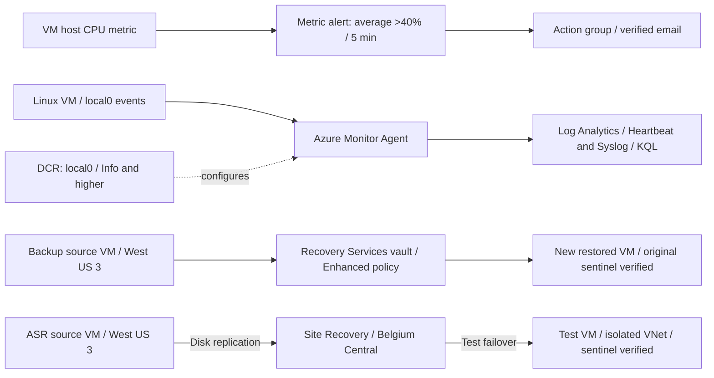

# Lab07 — Azure Monitoring, Backup and Site Recovery

Hilaire's personal AZ-104 learning path. Practice completed October 26–30, 2026 (Edmonton dates). Numbering belongs to this personal path, not the official Microsoft lab catalog.

**Status: all four practical blocks completed and cleaned up.** Monitoring, log collection, backup restoration and an isolated cross-region disaster recovery drill were verified. Blocks 1–3 used targeted Bicep adoption of existing resources. Block 4 used Bicep for the source infrastructure and the portal for Site Recovery configuration.

## Objective

Detect a VM CPU condition, deliver an email notification, collect and query Linux events, recover overwritten data from Azure Backup, and verify a VM recovery in another Azure region. Preserve evidence and remove active lab resources after each block.

## Architecture

The blocks were separate exercises with cleanup between them. These paths were not one continuously deployed environment.

## Verified exercises

| Block | Exercise | Observed result |
|---|---|---|
| 1 | CPU metric alert | Average Percentage CPU >40%, 5-minute window, evaluated every minute, severity 2, automatic resolution |
| 1 | Bounded CPU load and notification | Fired then Resolved observed; a later real trigger delivered the email after recipient verification |
| 1 | Bicep adoption | Action group and metric alert deployment succeeded; post-deployment settings and recipient verification checked |
| 2 | Agent and collection rule | AMA communication confirmed by Heartbeat; final DCR collected only local0 at Info and higher |
| 2 | KQL | Filtered events, projected fields, counted by severity and grouped in 5-minute intervals |
| 2 | Post-Bicep ingestion | New info/warning/error markers returned; excluded debug and alternate-facility controls absent in the filtered test |
| 3 | Azure Backup | Enhanced daily policy, 08:00 UTC, 7-day daily retention, 1-day instant recovery snapshots |
| 3 | Recover overwritten file | Version 2 replaced the source file; restored VM contained Version 1 with the original SHA-256 |
| 3 | Bicep adoption | Existing backup policy and protected item adopted; post-deployment Protected/Healthy and last backup Completed |
| 4 | Source baseline | Four-resource Bicep deployment succeeded; private Ubuntu 22.04 x64 VM, Trusted Launch, Standard SSD |
| 4 | Cross-region replication | West US 3 to Belgium Central reached Protected/Healthy; RPO displayed 5 minutes in the retained capture |
| 4 | Isolated test failover | All job steps succeeded; test VM booted and original sentinel SHA-256 matched |
| 4 | Cleanup | Test environment cleanup and replicated-item removal succeeded; all six inventoried lab groups were subsequently absent |

See [EVIDENCE.md](EVIDENCE.md) for validation boundaries and [REPRODUCTION.md](REPRODUCTION.md) for prerequisites, deployment commands and test steps.

## Repository contents

| File | Purpose |
|---|---|
| [bicep/block1.bicep](bicep/block1.bicep) | Metric alert and email action group; references an existing VM |
| [bicep/block2.bicep](bicep/block2.bicep) | Workspace, AMA extension, Syslog DCR and VM association |
| [bicep/block3.bicep](bicep/block3.bicep) | Enhanced backup policy and protected item; references existing vault/VM |
| [bicep/block4-baseline.bicep](bicep/block4-baseline.bicep) | Source NSG, VNet/subnet, NIC and VM; no ASR configuration |
| [scripts/prepare-asr-source.sh](scripts/prepare-asr-source.sh) | Source inspection, preliminary HTTPS checks, sentinel creation/hash |
| [scripts/verify-asr-sentinel.sh](scripts/verify-asr-sentinel.sh) | Read and compare the recovered sentinel against the recorded hash |
| [scripts/generate-syslog.sh](scripts/generate-syslog.sh) | Controlled local0 test messages and exclusion controls |
| [queries/heartbeat.kql](queries/heartbeat.kql) | Recent agent communication |
| [queries/syslog.kql](queries/syslog.kql) | Controlled Syslog test records |
| [queries/syslog-summary.kql](queries/syslog-summary.kql) | Counts by time bucket and severity |

The Bicep declarations are retained from the verified local models. The Block 4 output `targetRegionCandidate` still reads `eastus`: it records the original candidate, which was rejected. The actual successful target was **Belgium Central**. This output deploys no target resource. The separate verification/logging scripts and KQL files are reusable extracts of the practiced checks, not additional Azure deployments.

## Troubleshooting and lessons learned

| Observation | Resolution or interpretation |
|---|---|
| Sample action-group notification failed on the free subscription | The sample API returned Free subscription not supported. A real metric-alert email was successfully delivered after recipient verification. |
| Syslog test looked correct while DCR collected too broadly | CLI exposed other facilities at Debug. Set them to None; keep local0 at Info. Portal checkboxes select rows for bulk editing, not enabled facilities. |
| ARM validation accepted a candidate configuration | Validation and quota alone did not establish subscription region eligibility. Read the Allowed resource deployment regions assignment as well. |
| East US VNet/vault creation denied | Policy allowed Belgium Central, West US 3, Central US, North Central US and Norway East for this subscription at the time. Rechecked Belgium Central SKU restrictions and family/regional quotas. |
| Overall ASR ARM deployment failed on Automation | An Automation job referenced an absent parent account despite manual updates selected. This failure was retained; it was not relabeled as deployment success. ASR independently reached Protected/Healthy and the drill passed. |
| Test VM hostname matched the source | The recovered OS retained its hostname. Verify the selected Azure resource and data rather than using hostname alone. |
| Backup cleanup left an external restore-point collection | Revoked the specific outstanding disk restore-point SAS grant using endGetAccess, deleted the collection, then verified the external group was empty. |

## Scope and limitations

- Complete fresh reconstruction of the four blocks from this repository was not tested. Follow the existing-resource prerequisites for adoption templates.
- Block 4's test failover job took approximately 2m20s. This is a job duration, not a measured application recovery time or an RTO guarantee. Displayed RPO is a point-in-time observation, not a constant guarantee.
- Test failover was manually initiated into an isolated network. Production failover, failback, recovery plans, automated disaster detection, application dependency recovery and traffic redirection were not exercised.
- Availability Sets/zones were discussed conceptually; VM Insights and Connection Monitor were not verified practical exercises in this lab.
- Source/test VMs had no public IP. The ASR source subnet explicitly allowed platform default outbound access for the temporary exercise. This is not a production egress design. Preliminary login/ARM HTTPS probes did not independently validate every replication endpoint.
- A workspace daily ingestion cap is not a strict financial spending ceiling. Soft deletion is not immediate permanent erasure. Final cleanup evidence covers inventoried lab resources, not subscription-wide billing.

## References

- [Collect Syslog with Azure Monitor Agent](https://learn.microsoft.com/en-us/azure/azure-monitor/vm/data-collection-syslog)
- [Site Recovery disaster recovery drill](https://learn.microsoft.com/en-us/azure/site-recovery/azure-to-azure-tutorial-dr-drill)
- [Mobility service update settings](https://learn.microsoft.com/en-us/azure/site-recovery/azure-to-azure-autoupdate)
- [Azure VM backup support matrix](https://learn.microsoft.com/en-us/azure/backup/backup-support-matrix-iaas)
